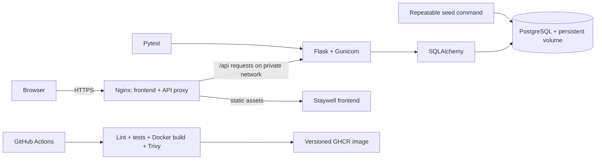

# Staywell Hotel Booking Demo

A small responsive hotel discovery and booking demo backed by a Flask API, PostgreSQL, Docker Compose, and Nginx HTTPS. Search the sample catalogue, check room availability, create a real reservation, and retrieve a booking using its reference and guest email. This demo does not take payments.

## Architecture



The database enforces the central booking rule with a PostgreSQL GiST exclusion constraint. It rejects two confirmed stays for the same room when their date ranges overlap, including writes racing from separate API workers. Date ranges include check-in and exclude check-out, so one guest can leave on the day the next arrives.

See [the architecture notes](docs/architecture.md) and [database schema diagram](docs/database-schema.md) for the service and data diagrams.

## Requirements

- Docker Desktop with Docker Compose, or Docker Engine plus the Compose plugin.
- Git.
- Python 3.12 for running the tests directly on the host (optional; a container test runner is provided).
- `mkcert` for a locally trusted HTTPS certificate (free). Self-signed certificates also work, but browsers will show a trust warning.

## Start locally (PowerShell)

1. Copy the example configuration and set a local password. Keep `.env` private and out of Git.

   ```powershell
   if (-not (Test-Path .env)) { Copy-Item .env.example .env }
   notepad .env
   ```

   Change `POSTGRES_PASSWORD` to a long local password and change the password in `DATABASE_URL` to the same value. The example value is for illustration only.

2. Create a local certificate for `localhost`.

   ```powershell
   New-Item -ItemType Directory -Force nginx/certs | Out-Null
   mkcert -install
   mkcert -key-file nginx/certs/localhost-key.pem -cert-file nginx/certs/localhost.pem localhost 127.0.0.1 ::1
   ```

3. Build and start the services.

   ```powershell
   docker compose up --build -d
   docker compose ps
   ```

   The database becomes healthy first, then the API initializes its schema and starts, then Nginx serves the frontend and proxies API calls. The PostgreSQL data is kept in the `postgres_data` named volume.

4. Add the sample room inventory. This command is safe to repeat.

   ```powershell
   docker compose exec api python -m database.seed
   ```

5. Check the service endpoints.

   ```powershell
   Invoke-RestMethod https://localhost/health
   Invoke-RestMethod https://localhost/ready
   ```

   HTTP on port 80 redirects to HTTPS on port 443. The API service itself is only reachable on the private Compose network; PostgreSQL is bound to `127.0.0.1` for local development tools.

6. Open the website in Chrome at **https://localhost**. Use a `mkcert` certificate to avoid browser trust warnings. The homepage shows three sample properties; their locations, descriptions, photos, and nightly rates are illustrative catalogue content. The availability count and all reservations are read from or written to the live PostgreSQL-backed API.

## API examples

Use dates in the future. Replace these examples with dates that are still ahead when you run them.

```powershell
$start = (Get-Date).Date.AddDays(30).ToString('yyyy-MM-dd')
$end = (Get-Date).Date.AddDays(32).ToString('yyyy-MM-dd')
Invoke-RestMethod "https://localhost/api/availability?check_in=$start&check_out=$end&room_type=standard"

$body = @{
  guest_name = 'Ada Lovelace'
  guest_email = 'ada@example.test'
  room_type = 'standard'
  check_in = $start
  check_out = $end
} | ConvertTo-Json
Invoke-RestMethod -Method Post -Uri https://localhost/api/reservations `
  -ContentType 'application/json' -Body $body
```

The response includes a booking reference such as `HB-XXXXXXXXXX`. If no room remains for the full date range, reservation creation returns HTTP `409`. Invalid/missing dates and fields return HTTP `400`.

| Endpoint | Purpose |
|---|---|
| `GET /health` | Process liveness and application version |
| `GET /ready` | Readiness check, including a PostgreSQL query |
| `GET /api/availability?check_in=YYYY-MM-DD&check_out=YYYY-MM-DD&room_type=standard` | Available rooms and count |
| `POST /api/reservations` | Create a confirmed reservation |
| `POST /api/reservations/lookup` | Retrieve a booking when both the reference and guest email in the JSON body match |

## Run automated tests

Tests use PostgreSQL because the important overlap protection is a PostgreSQL constraint. Do not point `TEST_DATABASE_URL` at a database with data you want to keep: the test fixture clears its test tables before each test.

Create an isolated test database in the local Compose PostgreSQL server, then run the Python 3.12 test runner container:

```powershell
docker compose exec db createdb -U hotel_app hotel_booking_test
docker compose --profile test run --rm tests
```

The test fixture clears tables only in `hotel_booking_test`, not in the demo database. The GitHub Actions workflow provisions its own temporary PostgreSQL service. The tests check health/readiness, room-type availability, references, persistence, invalid dates (including checkout before check-in), unknown room types, adjacent dates, full inventory, direct database overlap protection, and simultaneous conflicting requests. See the saved [isolated test output](docs/evidence/api-tests.txt).

To run the test suite directly on the host, create a Python 3.12 virtual environment and set `TEST_DATABASE_URL` to the isolated test database as shown in the workflow. The container test runner is the simpler Windows path.

## Useful development commands

```powershell
docker compose logs -f api
docker compose logs -f db
docker compose restart api
docker compose down                 # stop services; preserves database volume
docker compose up -d                # start again with persisted data
```

To completely delete local database data, run `docker compose down -v`. This is destructive and should not be part of ordinary restart or recovery.

## CI/CD and image versions

`.github/workflows/ci.yml` runs Ruff linting, PostgreSQL-backed Pytest, Docker build, and a Trivy scan for HIGH/CRITICAL vulnerabilities with no available fix excluded. On branch and version-tag pushes, it publishes images to GitHub Container Registry (GHCR), tagged with the source commit and, for `vX.Y.Z` releases, that release version. Branch pushes also publish `latest` on the default branch. Pull requests run verification and scanning without publishing.

The workflow scans the built image and then tags and publishes that same image. The Dockerfile pins the Python base image by digest and applies current Debian security updates during the image build; therefore the exact image produced by a run is the deployable artifact to retain for rollback.

To cut a version after pushing the commit to GitHub:

```powershell
git tag v1.0.0
git push origin v1.0.0
```

Repository Actions must be allowed to write packages (`GITHUB_TOKEN` package permissions). GHCR visibility and any account-level package settings may need to be adjusted in GitHub. CI results and image publication are not included as pre-created evidence in this repository.

## Backup, restore, recovery, and rollback

See [the operations runbook](docs/runbook.md) for deployment, backup/restore, recovery, and rollback procedures. Verified local runtime and recovery results are in [docs/evidence](docs/evidence/README.md).

For interview preparation, see [the project explanation guide](docs/interview-guide.md) and [the 3–5 minute demo script](docs/demo-script.md).

## Repository map

```text
app/                    Flask app, routes, models, startup helpers
database/seed.py        Repeatable sample inventory
tests/                  PostgreSQL-backed API and constraint tests
nginx/                  HTTPS reverse proxy configuration
.github/workflows/      CI, Trivy scan, GHCR image publication
docs/                   Operations, architecture, and evidence checklist
requirements.lock       Exact resolved Python package versions
```

## Limitations to explain in an interview

- This is a learning/demo deployment on one machine, not a highly available production system.
- `create_all` initializes a fresh schema. For long-lived production evolution, introduce reviewed, versioned Alembic migrations before changing table structure.
- The demo catalogue details and prices are static frontend content and are not stored as hotel records or rates in PostgreSQL. Room availability and reservations are real database operations. The API has no login, payment processing, cancellation workflow, rate limiting, or personal-data retention policy; do not expose it publicly as a real booking service.
- Local HTTPS certificates are for `localhost`. A public service needs a domain, a trusted certificate lifecycle, external secret management, backups stored off-machine, and a monitored deployment environment.
- The exclusion constraint is the concurrency-safe guard. The earlier availability query is for a helpful response and does not replace that database rule.
