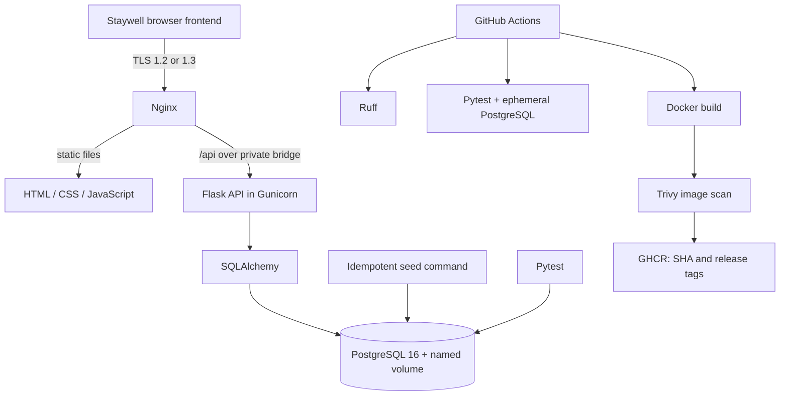

# Architecture notes

## Request and concurrency flow

1. Nginx redirects plain HTTP to HTTPS, serves the static Staywell frontend, and forwards `/api/` requests to Flask over the internal Compose bridge.
2. Flask validates JSON, date format, date ordering, guest fields, and room type.
3. SQLAlchemy queries for a room with no confirmed reservation whose stay intersects the requested interval.
4. The API inserts a reservation in a PostgreSQL transaction.
5. A PostgreSQL GiST exclusion constraint over room ID and `daterange(check_in, check_out, '[)')` guarantees that overlapping confirmed rows for a room cannot commit. A racing insert gets SQLSTATE `23P01`, mapped to HTTP `409`.

This uses half-open stays `[check_in, check_out)`: overlap is `existing.check_in < requested.check_out AND existing.check_out > requested.check_in`.

## Persistence and trust boundaries

- Only Nginx publishes the API endpoint. The database port is bound to loopback for local test access; remove that port mapping in a remote deployment.
- The PostgreSQL data directory lives in the `postgres_data` named volume. Container replacement does not delete it; `docker compose down -v` does.
- `.env` provides local configuration and is ignored by Git. GitHub-hosted CI uses a disposable test password and the workflow token for GHCR. Never put a production credential in source, a workflow literal, or an image layer.
- Health checks distinguish process liveness (`/health`) from database readiness (`/ready`).
- Logs are JSON lines on stdout/stderr for Docker collection.
- The sample frontend catalogue supplies illustrative property text, images, and prices. Availability and reservations are backed by PostgreSQL. Booking lookup accepts the reference and guest email in a JSON POST body to keep the email out of the URL.
