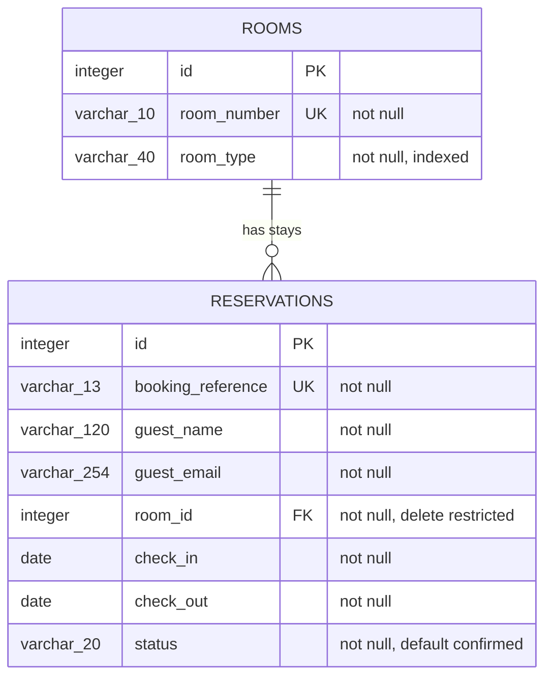

# Database schema

The schema is initialized by SQLAlchemy against PostgreSQL. `initialize_database` enables `btree_gist` and creates the tables if absent. The model definitions in `app/models.py` are authoritative.

## Constraints and booking behavior

- `rooms.room_number` is unique.
- `reservations.booking_reference` is unique and generated with a cryptographically secure random choice.
- `reservations.room_id` references `rooms.id`; deleting a room with reservations is restricted.
- `check_out > check_in` is enforced by `ck_reservation_dates_ordered`.
- `ex_reservation_room_dates_no_overlap` is a PostgreSQL GiST exclusion constraint on room ID and `daterange(check_in, check_out, '[)')`, restricted to confirmed rows. It prevents overlapping confirmed stays for one room even when concurrent transactions race.
- Stays use `[check_in, check_out)`, allowing a new stay to begin on the previous guest's departure date.

There is no separate hotel, property, rate, user, cancellation, or payment table in this demo. The frontend catalogue is illustrative static content; availability and reservations use the tables above.
